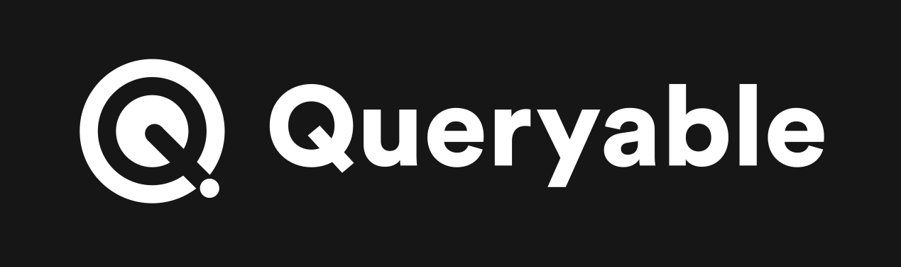

  

<h1 align="center">Queryable</h1>

  Annotation-driven REST APIs for Quarkus and Hibernate Panache.

  <a href="https://queryable.dev">Website</a> ·
  <a href="https://github.com/queryabledev/queryable">Queryable repository</a> ·
  <a href="https://github.com/queryabledev/queryable-tutorial">Queryable Tutorial</a>
   <a href="https://github.com/queryabledev/quarkus-queryable">Quarkus Queryable repository</a> ·
  <a href="https://github.com/queryabledev/quarkus-queryable-tutorial">Quarkus Queryable Tutorial</a>

## What is Queryable?

Queryable removes repetitive REST and filtering code from Quarkus
applications. Developers describe searchable fields directly on their JPA
entities; Queryable turns those annotations into REST endpoints, filtering,
sorting and pagination.

The project currently evolves from:

- **Queryable 3.x** — a Maven plugin that generates editable Java REST
  controllers and Hibernate filters;
- **Queryable 4.x** — a Quarkus extension designed around the official
  `quarkus-hibernate-orm-rest-data-panache` APIs, build-time generation and CDI
  extension points.

Queryable is open source under the Apache-2.0 license.
